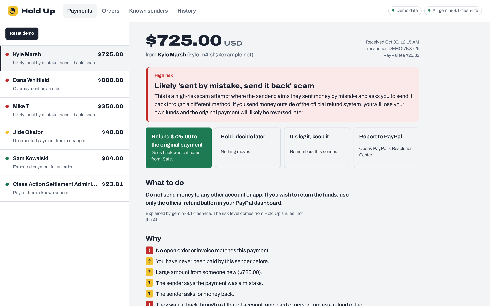

# Hold Up

**PayPal's scam alerts protect the person sending money. Hold Up protects the person receiving it.**

A stranger sends a small seller $725 with the note "inspection". An hour later: "Sorry, sent by mistake, please send it back to my other account, don't use the refund button." If the seller sends it back, the original payment (usually from a stolen card) is reversed later, and the seller loses the money twice.

Hold Up watches incoming PayPal payments, flags the ones that match no order, explains in plain words what's going on, and fixes it the one safe way: **refunding the original payment** through the PayPal API, so the money goes back where it came from. It never sends a new payment.



## What it does

1. **Watch.** Pulls incoming payments from PayPal (Transaction Search, the `PAYMENT.CAPTURE.COMPLETED` webhook, or a transaction ID from the "You've got money" email) and matches them against the seller's open orders and known senders.
2. **Explain.** Deterministic rules set the risk: no matching order, overpayment, a request to return money through another app or account, "don't use the refund button", "pay my shipper", text addressed to an AI. An LLM then explains the situation in plain words, lists the tactics it sees, and drafts a reply.
3. **Fix safely.** Four buttons, based on research on what actually stops payment fraud (see below):
   - **Refund to the original payment.** Calls `POST /v2/payments/captures/{id}/refund`, partial for overpayments. The seller types the amount to confirm.
   - **Hold, decide later.** Nothing moves.
   - **It's legit, keep it.** Optionally remembers the sender.
   - **Report to PayPal.** Opens the Resolution Center.

Every action is written to an audit log.

## Try it in two minutes (no keys needed)

Requires Node.js 23.6 or newer (Hold Up runs TypeScript directly, no build step).

```bash
git clone <this repo> && cd holdup
npm install
DEMO=1 npm start
# open http://localhost:8787
```

Demo mode loads six sample payments (a "sent by mistake" scam, an overpayment with a "shipper", a note that tries to instruct the AI, an unknown $40, an expected order and a settlement payout). Refunds in demo mode don't call PayPal. Add an `AI_API_KEY` to `.env` to see AI explanations; without one, Hold Up uses its rule-written explanations.

## Run it against the PayPal sandbox

1. In the [PayPal developer dashboard](https://developer.paypal.com/dashboard/applications/sandbox), create a sandbox app linked to a **US** business sandbox account. In the app's settings, tick **Transaction search**.
2. `cp .env.example .env` and fill in `PAYPAL_CLIENT_ID`, `PAYPAL_CLIENT_SECRET` and, optionally, `AI_API_KEY` (a free [Gemini key](https://aistudio.google.com/apikey) works).
3. `npm start`, then in another terminal create a real sandbox overpayment ($800 card payment against a $300 order):
   ```bash
   npm run seed -- overpayment
   ```
4. Open the link it prints and refund the $500. Check it with PayPal: `npm run seed -- check <capture id>` shows `PARTIALLY_REFUNDED`.

For the "stranger sends money" case, log into a **personal** sandbox account at sandbox.paypal.com, send money to your business account with the note "inspection", then add it with its transaction ID (button "Add by transaction ID", or `npm run seed -- add <id> <email> "<name>" "<message>"`). PayPal can take up to 3 hours to list a payment in Transaction Search; adding by ID works immediately.

Verified on 30 Oct 2026 in the sandbox: an $800 card payment partially refunded by $500 (`PARTIALLY_REFUNDED`), and a $725 person-to-person "send money" payment fully refunded (`REFUNDED`), both through Hold Up's UI.

## How it's built

```
PayPal ── Transaction Search / webhook / capture lookup ──▶ ingest ──▶ SQLite
                                                              │
                                     orders + known senders ──▶ rules (risk, category, evidence)
                                                              │
                         sender's note + message (quoted) ──▶ LLM: explanation, tactics, reply draft
                                                              │        (can raise risk, never lower it)
                                                              ▼
                                         seller decides ──▶ refund original capture (PayPal API)
                                                              │  typed confirmation, idempotency key
                                                              ▼
                                                          audit log
```

- **TypeScript on Node.js** with [Hono](https://hono.dev), `node:sqlite` and plain HTML/CSS/JS. Two runtime dependencies.
- **PayPal REST APIs:** OAuth 2.0 client credentials, Transaction Search (`/v1/reporting/transactions`), Payments v2 captures (`GET /v2/payments/captures/{id}`, `POST .../refund` with `PayPal-Request-Id`), webhook signature verification, and Orders v2 for the sandbox seed script.
- **AI:** any OpenAI-compatible chat endpoint. The default is Google's `gemini-3.1-flash-lite` on the free tier.

| File | What it does |
|---|---|
| `src/rules.ts` | The deterministic risk rules |
| `src/ai.ts` | Prompt, output checks, AI escalation |
| `src/paypal.ts` | The PayPal client; refund is its only money-moving call |
| `src/service.ts` | Ingest, analysis and the guarded refund |
| `src/server.ts` | HTTP API and webhook |
| `public/` | The seller's UI |
| `patterns/` | The open scam-pattern library and test sets |

## Safety design

The scammer writes the payment note and the follow-up message, so Hold Up treats both as hostile input ([OWASP LLM01: prompt injection](https://genai.owasp.org/llmrisk/llm01-prompt-injection/)).

- **Rules decide, the AI explains.** LLMs confuse scam types ([arXiv 2606.01475](https://arxiv.org/abs/2606.01475)), so the risk level comes from code. The AI may raise a medium risk to high when it spots an unsafe-return tactic; it can never lower one.
- **Sender text is fenced as data.** It's wrapped in a random marker the sender can't predict, and the prompt says it's never instructions. Text that tries to talk to the AI is itself a strong risk signal.
- **The AI has no tools.** It returns JSON that is checked: unknown fields are dropped, and a reply draft that mentions another payment route or claims a refund already happened is replaced.
- **One money tool, behind a human.** The only call that moves money refunds the original capture, never more than what's left. The seller types the amount to confirm, and an idempotency key means a double click or retry can't refund twice.
- **The UI never renders sender text as HTML.**
- **Local only, unless it's the demo.** Hold Up has no login, so it listens on `127.0.0.1` and refuses any other `HOST` outside demo mode. Webhooks are accepted only with a verified PayPal signature, so nobody can feed in fake payments.

## Why these buttons

- Warnings shown only on risky payments, with clear buttons (cancel, save for later, call the bank), made people **81% less likely** to fall for fraud in a randomised experiment with about 10,000 UK adults; generic warnings cut it by only 18% and wore off ([Akesson, Gathergood & Quispe-Torreblanca 2023](https://ssrn.com/abstract=4532757)).
- Warnings that interrupt the decision were heeded by 79% of people, passive ones by 13% (Egelman, Cranor & Hong, CHI 2008).
- Making people engage before acting reduces over-reliance on AI suggestions (Buçinca et al., CSCW 2021), hence the typed confirmation.
- PayPal's own help pages say an overpayment may come from a stolen card and suggest cancelling the order, and Venmo tells people not to return money on their own. Hold Up's refund button and "Report to PayPal" follow that advice.

## Scam patterns and how well it works

`patterns/` holds 40 hand-checked public posts about unexpected incoming money, paraphrased test messages and an evaluation script. On 14 messages written after the rules were tuned:

- **Rules alone:** 4 of 7 scams flagged high risk, with no false alarms.
- **Rules plus the AI layer:** 7 of 7, still with no false alarms.

The other three scams still got a medium-risk warning and the safe refund button. Details and caveats are in [patterns/README.md](patterns/README.md).

## Tests

```bash
npm test          # rules, AI output checks, refund guards (against a fake PayPal)
npm run typecheck
npm run eval
```

## Limits

- **One merchant.** A real product would onboard sellers through PayPal's partner onboarding instead of one set of API keys.
- **Delayed detection.** Transaction Search can lag up to 3 hours; webhooks are the real-time path.
- **No sender email from webhooks.** The capture webhook doesn't include the sender's email, so stranger checks are stronger once Transaction Search catches up.
- **PayPal keeps its fee on a refund.** The refund dialog says so.
- **A refund doesn't legally stop a chargeback.** If a card owner disputes a payment the seller already refunded, the PayPal refund ID in Hold Up's history is the seller's evidence.
- **Not legal or financial advice.** If money was stolen, report it to PayPal.

## AI tools used

- **In the product:** Google Gemini (`gemini-3.1-flash-lite`, free tier) explains flagged payments, lists scam tactics in the sender's text and drafts replies, within the limits above.
- **In development:** Claude (Anthropic) was used as a coding assistant for research, code and tests.

## License

MIT. See [LICENSE](LICENSE).
